

  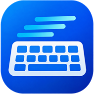

  <h1>SM Type Test</h1>

  
<strong>A typing practice and evaluation app for general typing and Indian government exams, for Windows.</strong>

  

    
    
    
    
  

   

---

Pick an exam profile, or use Practice mode to set your own countdown and scoring percentage. Type the passage in your language and see your score the way the exam would mark it. Your results and progress are saved, so you can follow your improvement over time.

  <strong>Current version:</strong> 0.1.0 (build 2026.1105) [updated from initial build: 2026.1010]
  

 

  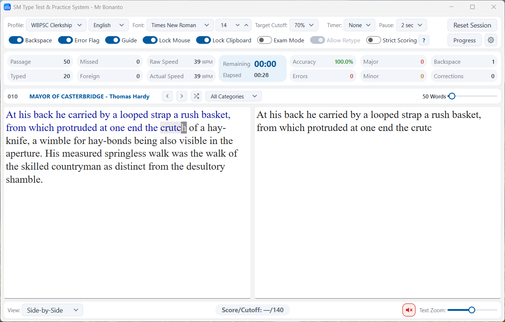

 

## Reason I built

_This project I started as a quiet effort to support someone's endeavour towards govt exams! I could not find any good place I can recommend to Her to practice typing effortlessly, with all features, and perfect simulation of exam halls. Every other places just asks for money to use extra features, and also - requires Internet. Hence, **SM Type Test**. - This Software entirely exists because of Her. Now opened for everyone, free forever; If you find this useful; all thanks and blessing goes to Her._ _- Bonanto._ 

## Download

Get `SMTT_Setup_0.1.0_2026.1105.exe` from the [**Latest** release](https://github.com/bonanto/smtt/releases/latest).

## Features

- WBPSC and WBSSC Group-C exam profiles
- Custom/Practice Profile. Practice mode for any exam: set your own countdown and scoring percentage
- Typing in multiple languages
- Mock tests Window - Simulates Exam Hall situation.
- Live progress reports and a results viewer - Keep Track of your Progresses. 
- Two scoring modes, **Strict** and **Exam Profile**, with a real-time score simulation
- Hardcopy mode with OCR and saved passages
- Notification shounds
- Exam Hall Simulation with Hall Noise (Keybaord sounds and hall sounds). You can Turn off or Customise in Settings

_More exam profiles, such as RRB NTPC, are coming soon. Until then you can prepare for any exam in Practice mode._

 

  <table>
    <tr>
      <td align="center">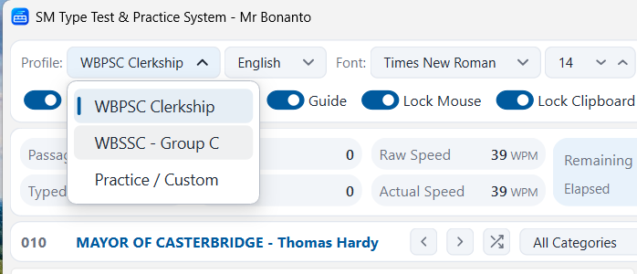 Exam Profiles</td>
      <td align="center">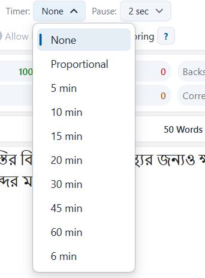 Practice: Custom Timers</td>
      <td align="center">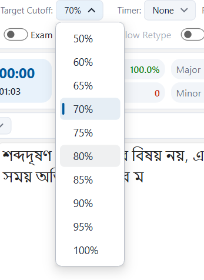 Practice: Target Cutoffs</td>
    </tr>
  </table>

 

## How it works

### Scoring

Every test can be scored two ways, so you can see how an exam would mark you:

- **Strict:** a plain, character-accurate score.
- **Exam Profile:** the marking rules of the selected exam.

The score updates as you type, as a real-time simulation.

  <table>
    <tr>
      <td align="center">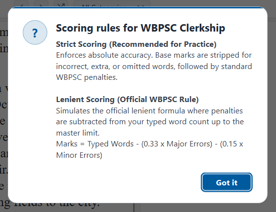 Live Rule Viewer</td>
      <td align="center">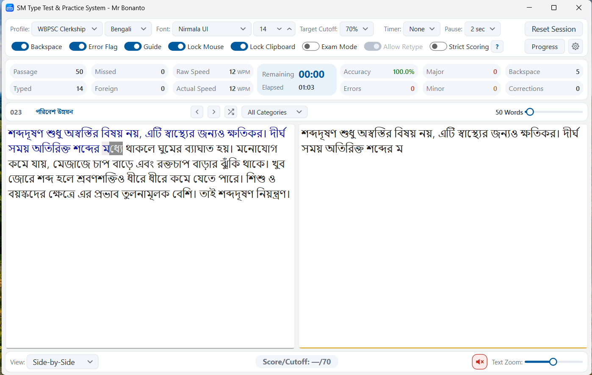 Multi-language Support (Bangla)</td>
    </tr>
  </table>

### Hardcopy mode

Some exams give you a printed passage to copy. Hardcopy mode is made for that:

1. Give the app an image, a PDF or plain text.
2. Images and PDFs are read with OCR (English and Bengali).
3. Check the extracted text and correct it if needed.
4. Type against the verified passage.

The passage is saved permanently, so you never need to scan the same page twice.

> _Note: Must select correct language for OCR, otherwise OCR will not be done properly_

### Progress and results

Reports update as you practise, and the results viewer lets you look back at earlier tests.

  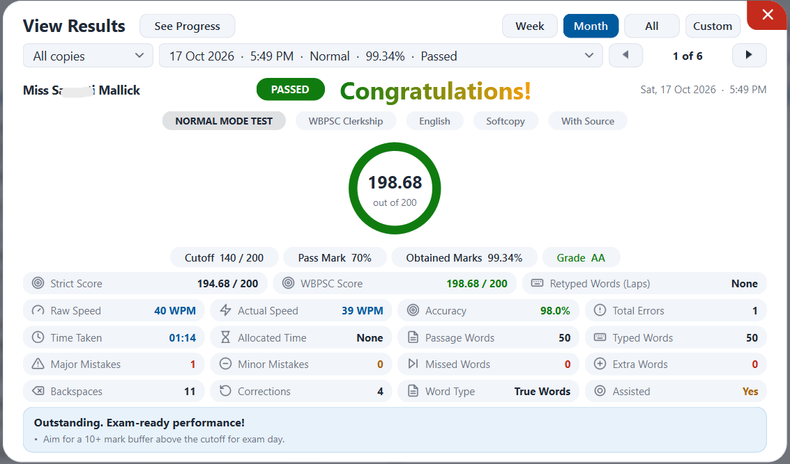 Comprehensive Results Viewer
    
  <table>
    <tr>
      <td align="center">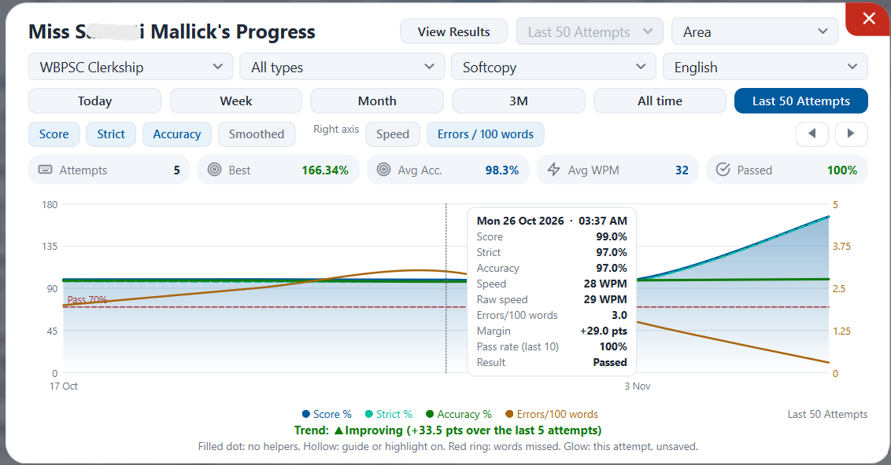</td>
      <td align="center">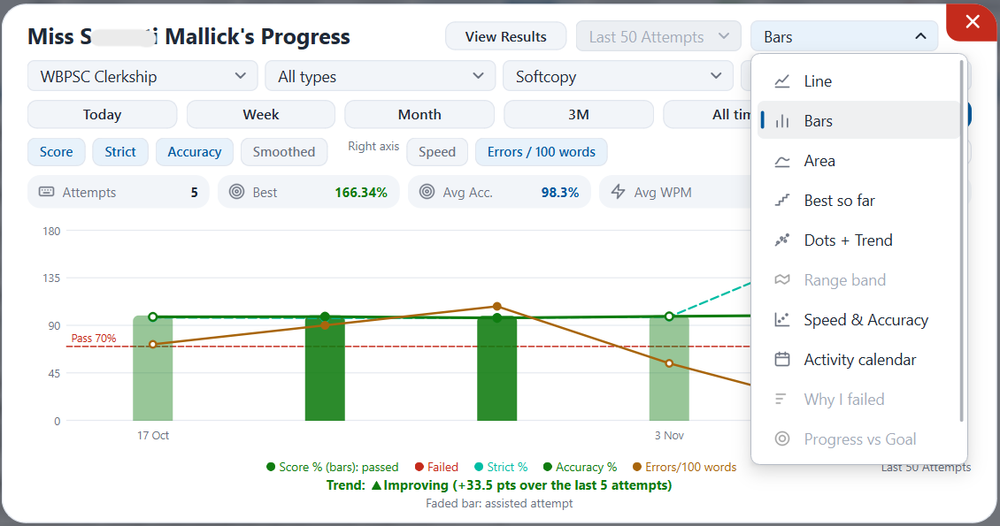</td>
      <td align="center">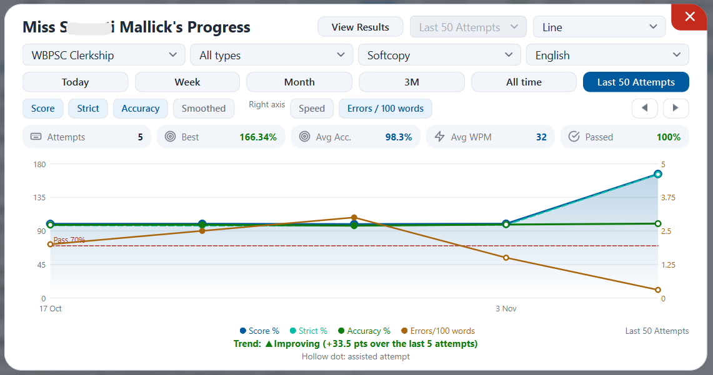</td>
    </tr>
  </table>

## Installation

**Requirements:** Windows 10 or 11, 64-bit. and 400MB of Free Space.

1. Download `SMTT_Setup_0.1.0_2026.1105.exe` from the [Latest release](https://github.com/bonanto/smtt/releases/latest).
2. Run it, read the license, and choose **Accept and Install**.
3. When it finishes, click **Finish**. SM Type Test opens automatically.

**Notes:**
- If Windows Smart Screen Shows up, Click : More Info > Run Anyway. 
- It installs for your user account only. Administrator rights are not needed.
- It adds a Desktop and a Start menu shortcut, and an entry in Windows Settings under Apps.
- The installer is not code-signed yet, so Windows SmartScreen may show a warning. Choose **More info**, then **Run anyway**.
- If your antivirus flags the installer, it is a false positive. Please report it through the issues page.

_New Features and SHA-256 of the installer: shown in the release notes._

### Upgrade, repair, reinstall uninstall

Run the installer again on a computer that already has SM Type Test. It asks what to do:

- **Upgrade:** available when the installer is a newer build than the installed one.
- **Repair:** reinstalls the program files to fix anything missing or damaged.
- **Reinstall:** complete reinstallation. First it uninstalls then re-installs automatically.  
- **Uninstall:** removes the app, then confirms that it was removed.

You can also uninstall from Windows Settings, under Apps.

## Your data and privacy

Your settings, progress and saved passages live in the `.smtt` folder in your user folder. The installer never overwrites an existing passages database, and uninstalling keeps this folder. To remove all your data, delete the `.smtt` folder after uninstalling.

SM Type Test does not collect or upload your typing data. The only network use is the optional update check described below.

## Updates

SM Type Test can check GitHub for new versions, new passages and OCR updates. You can set how often it checks (twice a day, once a day, every launch or manual only), skip checks on metered connections, and choose whether updates download automatically. Downloads are verified before they are used, and an update that fails is undone.

## Troubleshooting

- If the app closes unexpectedly, it writes details to `crash.log` in the `.smtt` folder. Please attach it when you report an issue.
- Report problems at [github.com/bonanto/smtt/issues](https://github.com/bonanto/smtt/issues).

## Third-party software & Licenses

SM Type Test includes third-party components, such as the Python runtime and packages, Qt, Tesseract OCR, Hunspell dictionaries and the Noto Emoji font. Each keeps its own license. The licenses and credits are shown in the app's About page.

  <table>
    <tr>
      <td align="center">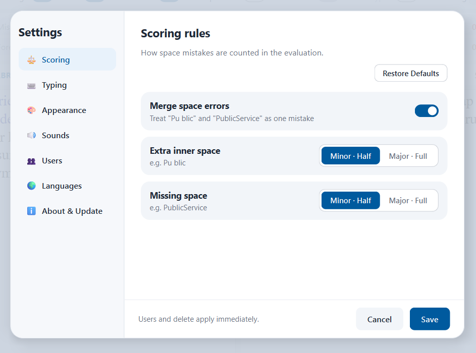 Scoring Configuration</td>
      <td align="center">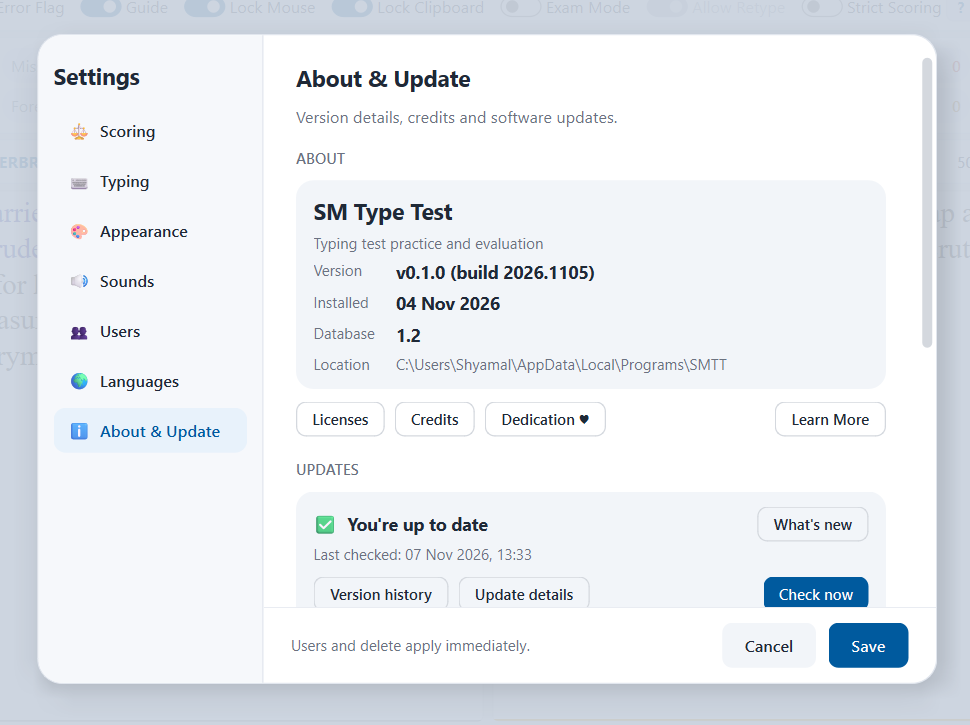 About & Licenses</td>
    </tr>
  </table>
    <table>
    <tr>
      <td align="center">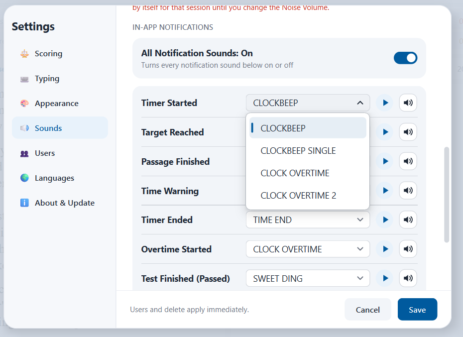 Notification Sounds</td>
      <td align="center">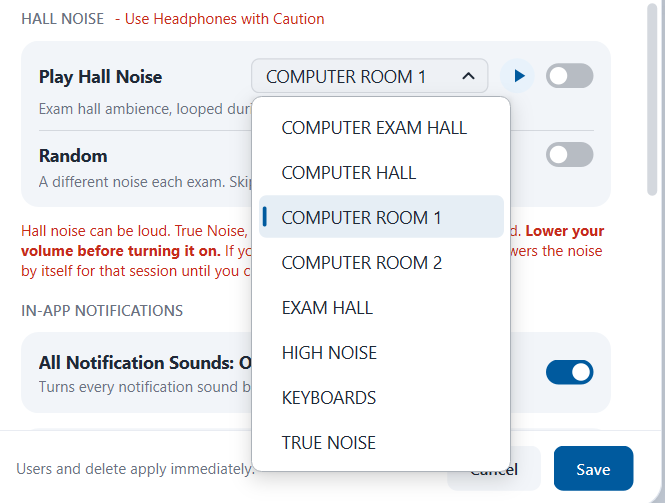 Exam Hall Simulation</td>
    </tr>
  </table>

## License

SM Type Test is proprietary software. See [LICENSE](LICENSE.md). The full End-User License Agreement is shown during installation.

---

  Copyright © 2026 Bonanto. All rights reserved. 
  Made with love...❤️

