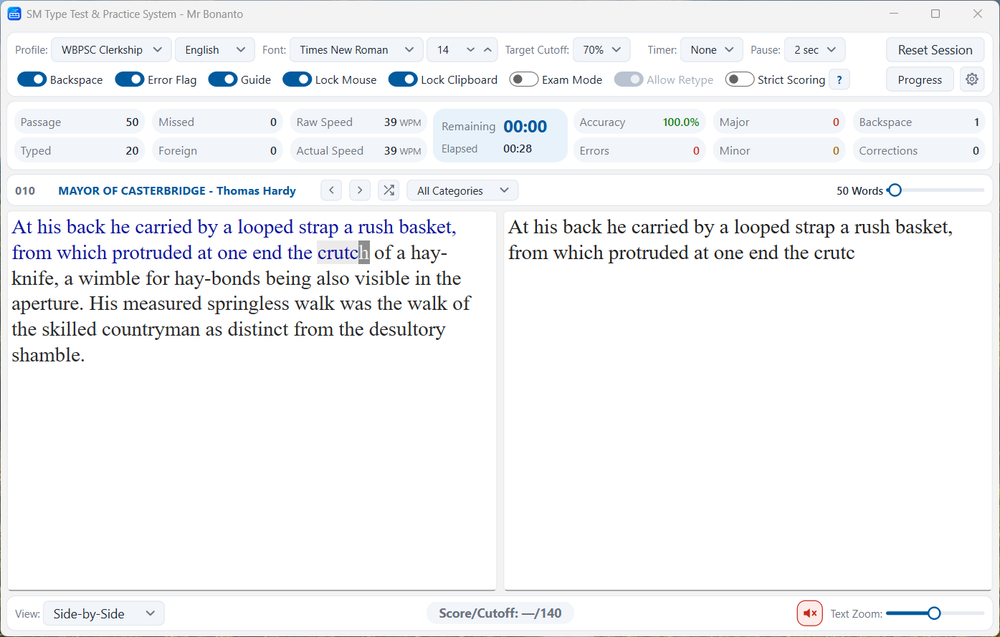
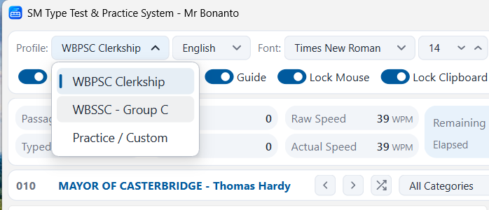
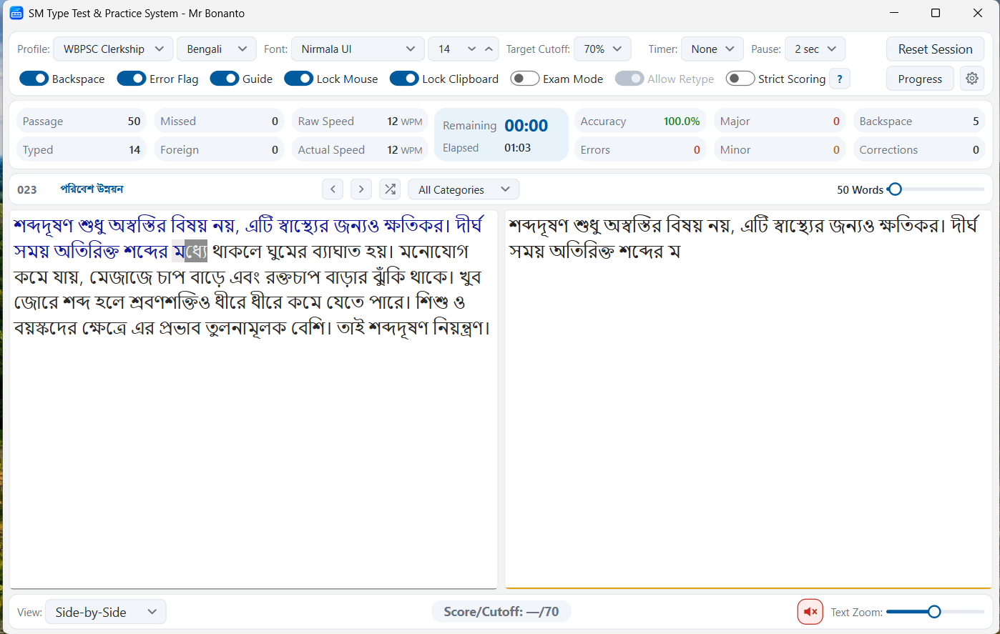
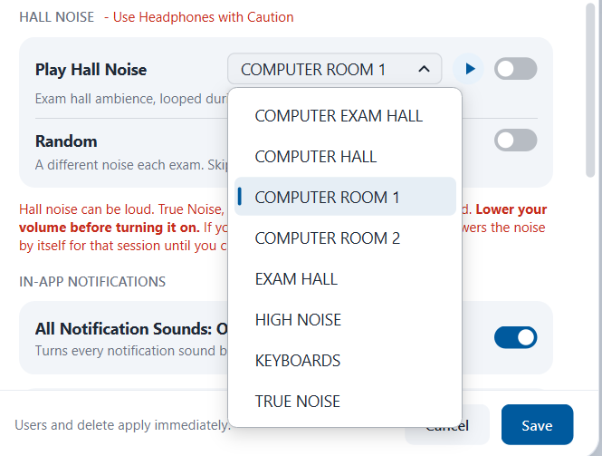
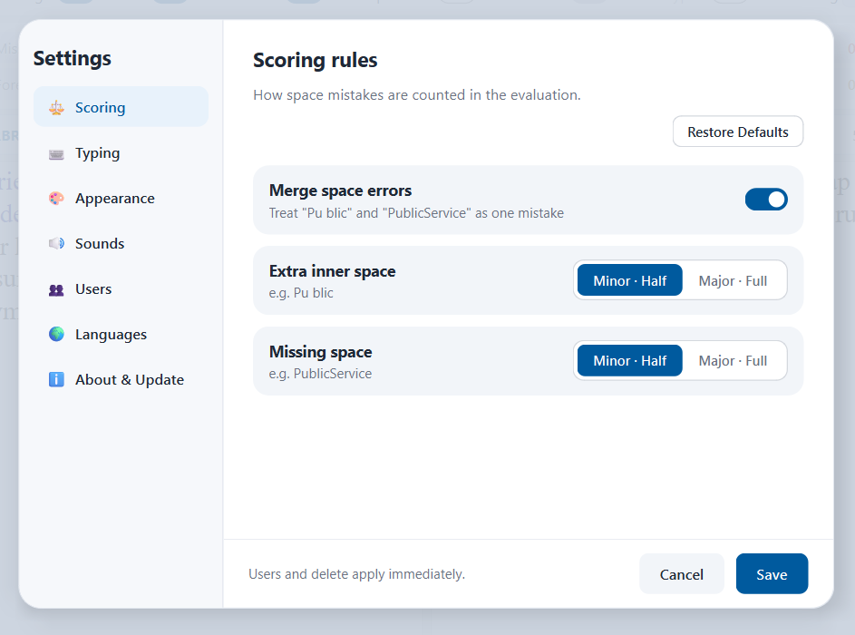
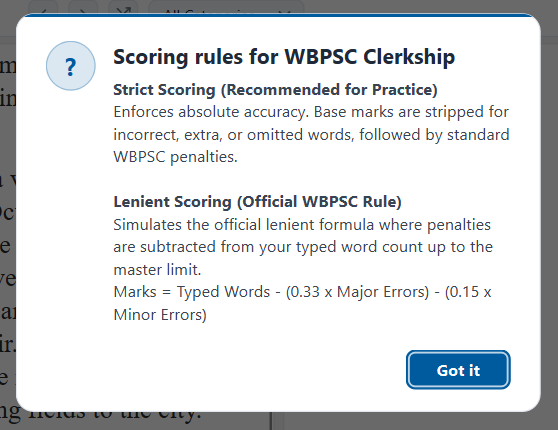
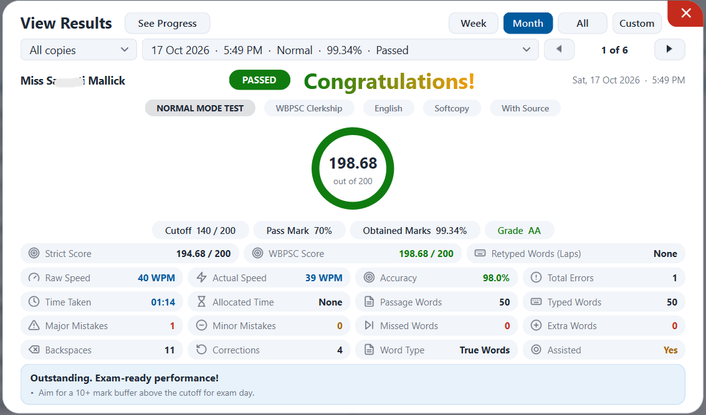
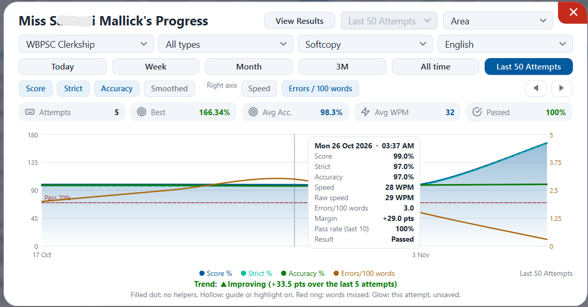
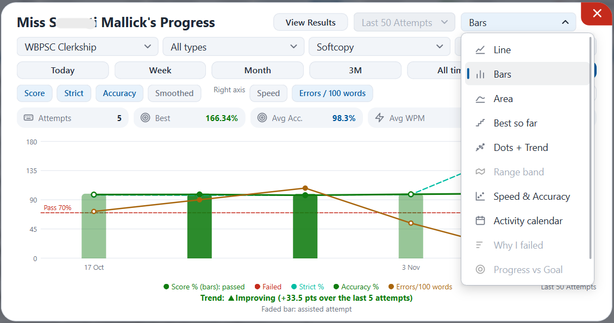
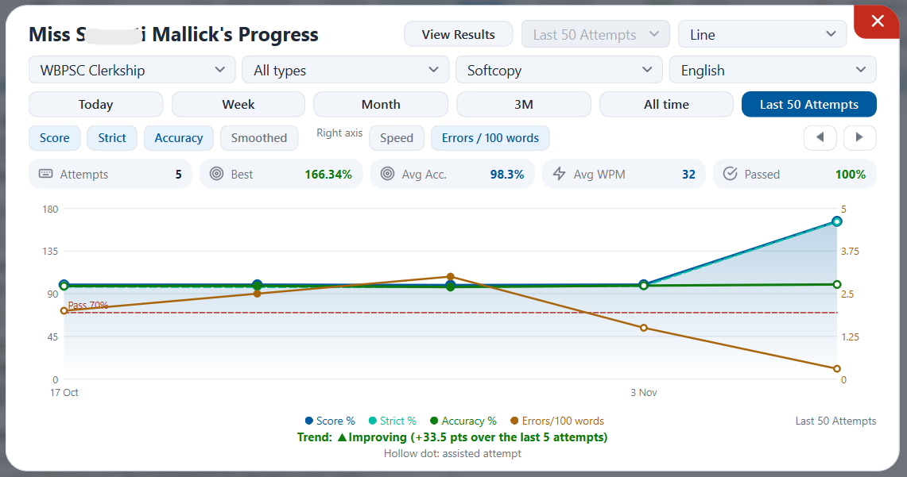

  
  <h1>SM Type Test</h1>
  
<b>A professional typing practice and evaluation application for Windows, designed for general typing and Indian government exams.</b>

  

    
    
    
  

  
    
  
  

  

> _This project I started as a quiet effort to support someone's endeavour towards govt exams! I could not find any good place I can recommend to Her to practice typing effortlessly, with all features, and perfect simulation of exam halls. Every other places just asks for money to use extra features, and also - requires Internet. Hence, **SM Type Test**. - This Software entirely exists because of Her. Now opened for everyone, free forever; If you find this useful; all thanks and blessing goes to Her._ _- Bonanto._

---

## 🚀 Core Features

Pick an exam profile, or use Practice mode to set your own countdown and scoring percentage. Type the passage in your language and see your score the way the exam would mark it. Your results and progress are saved locally, so you can follow your improvement over time.

* **Dedicated Exam Profiles:** Pre-configured rules for WBPSC and WBSSC Group-C (RRB NTPC coming soon).
* **Practice Profile:** Set your own countdown and target scoring percentage.
* **Multi-Language Support:** Type effortlessly in English, Bengali, and more.
* **Exam Hall Simulation:** Mock test windows with authentic ambient hall noise and keyboard sound simulations.
* **Hardcopy Mode with OCR:** Extract text from printed passages via image or PDF.
* **Real-Time Scoring:** Choose between **Strict** (character-accurate) and **Exam Profile** (official marking rules).

 

  <table>
    <tr>
      <td align="center"> <b>Exam Profiles</b></td>
      <td align="center"> <b>Multi-language Support</b></td>
      <td align="center"> <b>Hall Simulation</b></td>
    </tr>
  </table>

---

## ⚙️ How It Works

### Live Real-Time Scoring
Every test can be scored two ways. **Strict** gives you a plain, character-accurate score, while **Exam Profile** applies the specific marking rules of your selected exam. The score updates dynamically as you type, offering a true real-time simulation.

  <table>
    <tr>
      <td align="center"> <b>Scoring Configuration</b></td>
      <td align="center"> <b>Live Rule Viewer</b></td>
    </tr>
  </table>

### Hardcopy & OCR Mode
Some exams give you a printed passage to copy. Hardcopy mode handles this perfectly:
1. Provide the app with an image, a PDF, or plain text.
2. Images and PDFs are read locally with OCR (English and Bengali).
3. Check the extracted text and correct it if needed.
4. Type against the verified passage. 
*(The passage is saved permanently, so you never need to scan the same page twice).*

### Comprehensive Progress Tracking
Reports update as you practice. The detailed results viewer lets you look back at earlier tests, analyze your errors, and visualize your speed and accuracy trajectory.

  
  

    
    
    
  

---

## 💻 Installation

**Requirements:** Windows 10 or 11 (64-bit) and 400MB of free space.

1. Download the installer using the button at the top of this page.
2. Run it, read the license, and choose **Accept and Install**.
3. SM Type Test will open automatically.

**Notes:**
* *SmartScreen:* The installer is not yet code-signed. If Windows SmartScreen shows a warning, click **More info** > **Run anyway**.
* *Permissions:* It installs for your user account only. Administrator rights are not needed.

## 🛡️ Privacy & Data
SM Type Test does not collect, track, or upload your typing data. Your settings, progress, and saved passages live completely offline in the `~\.smtt` folder. Please read our complete [Privacy Policy](privacy) for full details on our offline-first architecture.

 

  

 

---

  
Copyright © 2026 Bonanto. All rights reserved.

  
<i>Made with love...❤️</i>

